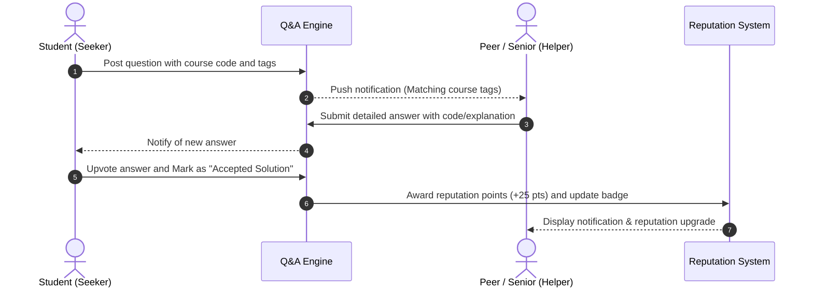
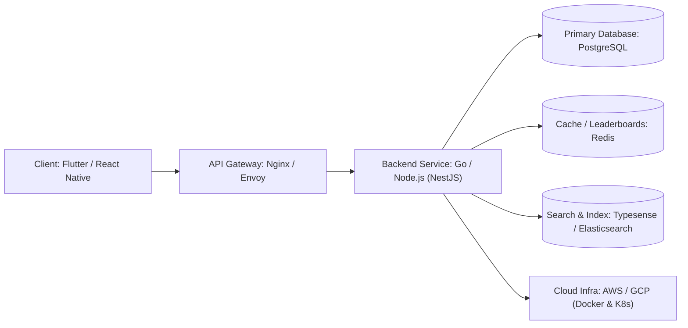

# Product Requirement Document (PRD)

## Document Details
- **Project Name:** CampusHive
- **Document Version:** 1.0.0 (Baselined)
- **Document Status:** Approved / Baselined
- **Target Audience:** Engineering Team, UI/UX Designers, Product Managers, Academic Evaluators
- **Last Updated:** October 2026

---

## 1. Executive Summary & Vision

### 1.1 Product Vision
**CampusHive** is a dedicated peer-to-peer academic and collaboration platform designed exclusively for university students. The application bridges the gap between classroom lectures and independent study by empowering students to ask course-specific questions, receive crowd-sourced answers from peers, and connect across faculties to pitch and build collaborative projects.

### 1.2 Problem Statement
1. **Academic Isolation & Roadblocks:** University students often get stuck on complex assignments and problem sets outside of lecture hours when teaching assistants and professors are unavailable.
2. **Fragmented Communication Channels:** Academic discussions currently happen across fragmented platforms (WhatsApp, Telegram, Discord, Line) with disorganized threads, no searchability, and high noise-to-signal ratios.
3. **Siloed Disciplines:** Students with creative project, research, or startup ideas struggle to find peers from other faculties (e.g., Computer Science students seeking Business or Design partners).
4. **Lack of Peer Recognition:** Active students who regularly help classmates receive no formal acknowledgment, reducing long-term motivation to assist others.

### 1.3 Value Proposition
CampusHive consolidates academic Q&A and interdisciplinary project collaboration into a verified, structured, and gamified campus environment.

---

## 2. Product Goals & Success Metrics

### 2.1 Primary Goals
- Provide an organized, searchable Q&A hub categorized by university, major, and course subject.
- Enable cross-faculty matchmaking for projects, competitions, and study groups.
- Incentivize peer assistance through a transparent reputation score and badge system.

### 2.2 Key Performance Indicators (KPIs)
| Metric | Description | Target (Post-Launch 3 Months) |
| :--- | :--- | :--- |
| **Active Engagement** | Daily Active Users / Monthly Active Users (DAU/MAU) | > 35% |
| **Resolution Rate** | Questions receiving an accepted answer within 24 hours | > 75% |
| **Response Latency** | Median time to first peer response | < 20 minutes |
| **User Retention** | 30-day user retention rate | > 50% |
| **Collaboration Index** | Interdisciplinary project teams formed via the Idea Hub | > 100 teams |

---

## 3. User Personas

### Persona A: The Struggling Underclassman (Seeker)
- **Name:** Budi Prasetyo (2nd Semester, Computer Science)
- **Pain Points:** Intimidated to ask lecturers basic coding questions; struggles with late-night debugging; existing class chat groups are cluttered.
- **Goals:** Quickly find answers to specific course exercises and connect with senior mentors without feeling judged.

### Persona B: The Motivated Peer Tutor (Helper)
- **Name:** Amanda Kusuma (6th Semester, Information Systems)
- **Pain Points:** Enjoys explaining concepts but receives no tangible recognition or record of academic mentorship.
- **Goals:** Share knowledge, earn verifiable reputation badges to showcase on her resume/LinkedIn, and review tricky course material before exams.

### Persona C: The Project Initiator (Builder)
- **Name:** Kevin Wijaya (4th Semester, Industrial Engineering)
- **Pain Points:** Has an innovative idea for a campus logistics app and business plan competition, but does not know software developers or UI/UX designers.
- **Goals:** Post project briefs, filter student profiles by technical skills, and recruit a balanced multidisciplinary team.

---

## 4. System Architecture & Information Flow

### 4.1 Application Information Architecture

```mermaid
flowchart TD
    AppRoot["CampusHive App"]
    
    AppRoot --> AuthModule["1. Auth & Onboarding"]
    AuthModule --> SSO["Campus SSO / University Email Verification"]
    AuthModule --> ProfileSetup["Major, Year, Skill Tags"]

    AppRoot --> QnAModule["2. Academic Q&A Feed"]
    QnAModule --> FilterCourse["Filter by Faculty / Course / Tag"]
    QnAModule --> PostQuestion["Rich Text & Code Snippet Editor"]
    QnAModule --> AnswerThread["Peer Answers & Accepted Solutions"]

    AppRoot --> IdeaHub["3. Idea & Project Hub"]
    IdeaHub --> PitchIdea["Create Project Pitch"]
    IdeaHub --> TalentSearch["Browse Needed Roles / Skills"]

    AppRoot --> Gamification["4. Reputation & Rewards"]
    Gamification --> Leaderboard["Subject-based Leaderboards"]
    Gamification --> Badges["Achievement & Tutor Badges"]

    AppRoot --> ChatModule["5. Communication"]
    ChatModule --> DirectChat["1-on-1 Mentorship Chat"]
    ChatModule --> GroupRooms["Course Study Rooms"]
```

### 4.2 Question Lifecycle Workflow

---

## 5. Functional Requirements (Features & Specifications)

### Module 1: Authentication & User Profiles
- **FR-1.1:** Sign up and login using university email domain (`*.ac.id` or `*.edu`) or integrated Campus Single Sign-On (SSO).
- **FR-1.2:** Profile creation: Full name, university ID (NIM/Student ID - private/verified), department, faculty, enrolled semester, and skill tags.
- **FR-1.3:** Privacy toggle: Option to post questions in "Pseudonymous Mode" (hiding student identity while displaying verified student badge) to reduce asking anxiety.

### Module 2: Course-Based Q&A Forum
- **FR-2.1:** **Subject Hierarchy:** Forum categorized by *Faculty -> Department -> Course Code/Name* (e.g., *Engineering -> CS -> Data Structures*).
- **FR-2.2:** **Rich Content Editor:** Support for Markdown, LaTeX math rendering for formulas, and syntax-highlighted code blocks.
- **FR-2.3:** **Attachment Support:** Image uploads (up to 5MB, JPG/PNG/PDF) for diagrams and handwritten notes.
- **FR-2.4:** **Voting & Accepted Answer:**
  - Upvote/downvote mechanism on answers.
  - The original poster can select one answer as the "Accepted Solution" (pins to top).
- **FR-2.5:** **Faceted Search:** Real-time semantic search with auto-suggest for similar existing questions to prevent duplicate posts.

### Module 3: Idea & Project Exchange Hub
- **FR-3.1:** **Project Pitch Creation:** Users can publish project cards with title, summary, goals, and open role slots (e.g., "Need Flutter Dev", "Need UI Designer").
- **FR-3.2:** **Application Workflow:** Interested students can click "Apply to Join" with a 150-word introduction and portfolio link.
- **FR-3.3:** **Project Status Indicators:** Active, Recruiting, In-Progress, Completed.

### Module 4: Gamification & Reputation Engine
- **FR-4.1:** **Points Allocation:**
  - Answer upvoted: `+10 points`
  - Answer accepted as best solution: `+25 points`
  - Valid question posted: `+2 points`
  - Downvoted content: `-2 points`
- **FR-4.2:** **Badges & Tiers:**
  - *Novice Inquirer*, *Curious Explorer*, *Course Subject Specialist*, *Campus Top Mentor*.
- **FR-4.3:** **Leaderboards:** Weekly and all-time leaderboards per department (encourages friendly academic competition).

### Module 5: Direct Messaging & Study Rooms
- **FR-5.1:** Real-time 1-on-1 direct messaging between verified students.
- **FR-5.2:** Temporary virtual study rooms for upcoming exam dates with integrated link sharing.

### Module 6: Moderation & Content Safety
- **FR-6.1:** Automated toxicity and profanity filtering.
- **FR-6.2:** Anti-cheating policy enforcement: Flags explicit exam-time leaks or academic dishonesty solicitations.
- **FR-6.3:** Community flag/report button with moderator dashboard.

---

## 6. Non-Functional Requirements (NFR)

| Category | Requirement Specification |
| :--- | :--- |
| **Performance** | API response time < 200ms for 95% of requests. App cold-start time < 2.0s. |
| **Scalability** | Cloud-native architecture capable of supporting 50,000 concurrent users during midterm and final exam weeks. |
| **Security & Privacy** | TLS 1.3 encryption for in-transit data; AES-256 for at-rest storage. Strict GDPR & Indonesian PDP Law compliance. |
| **Availability** | 99.9% uptime SLA during academic semesters. |
| **Mobile Responsiveness** | Native iOS and Android interfaces supporting varied screen sizes and dark/light themes. |

---

## 7. Recommended Technology Stack

- **Frontend:** Flutter or React Native (Cross-platform iOS & Android).
- **Backend:** Go (Golang) or Node.js (NestJS) with RESTful API & WebSocket for live chat.
- **Database:** PostgreSQL (Relational integrity for users, courses, and questions).
- **Caching & Leaderboards:** Redis (Sorted Sets for real-time gamification rankings).
- **Search:** Typesense or Elasticsearch (Fast instant search for past questions).

---

## 8. Release Roadmap

### Phase 1: MVP (Minimum Viable Product - Months 1-2)
- Student email authentication.
- Core Course Q&A forum with markdown and image attachment.
- Upvoting and "Accepted Answer" selection.
- Basic user profile and reputation counter.

### Phase 2: Collaboration & Gamification (Months 3-4)
- Idea & Project Exchange Hub with open role applications.
- Departmental leaderboards and milestone badges.
- Direct messaging between verified collaborators.

### Phase 3: Expansion & Integrations (Months 5-6)
- University LMS integration (Canvas / Moodle SSO & course syncing).
- Live audio/study rooms.
- Campus club & event announcements.

---

## 9. Appendix & Risks Analysis

| Risk | Impact | Likelihood | Mitigation Strategy |
| :--- | :--- | :--- | :--- |
| **Academic Dishonesty (Exam cheating)** | High | Medium | Implement lockdown tags during known exam windows; enforce strict ban policy for exam paper leaks. |
| **Cold-Start Low Engagement** | High | High | Partner with campus teaching assistants and honor societies to act as initial verified seed helpers with incentives. |
| **Unanswered Questions** | Medium | Medium | Automated bot notification reminding top-rated subject seniors about unanswered questions with bonus reputation bounties. |
